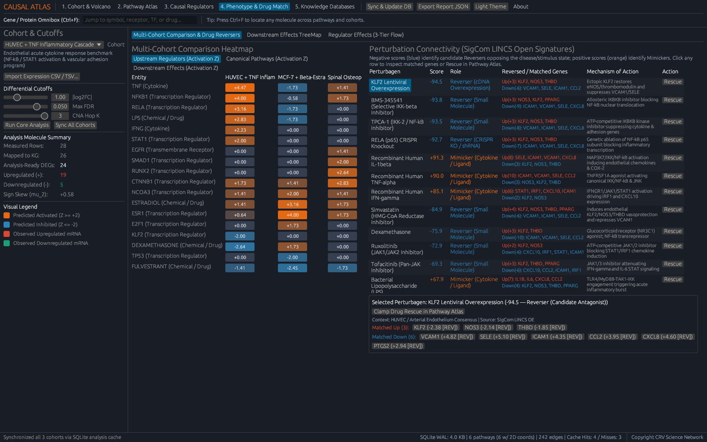

# Causal Atlas (`causal-atlas` v0.2.0)



**Causal Atlas** is an independent, clean-room native Rust desktop GUI, terminal UI, and CLI workbench for causal biological pathway, upstream regulator, mechanistic network, and perturbation signature inference backed by a bundled **SQLite 3 WAL caching engine** and open-source biomedical data streams.

## Clean-Room & Bundled Architecture

- **100% Independent Implementation**: Built from peer-reviewed statistical and graph-theoretic publications ([Krämer et al., 2014, PMC3928520](https://pmc.ncbi.nlm.nih.gov/articles/PMC3928520/)) without referencing proprietary SDKs, APIs, or commercial knowledge bases.
- **Zero External Runtime Dependencies**:
  - Enforces `#![forbid(unsafe_code)]` across all workspace crates (`ca-core`, `ca-streams`, `ca-app`).
  - Statically bundles SQLite 3 (`rusqlite` with `bundled` feature) in **WAL (`Write-Ahead Logging`)** mode — no external system `libsqlite3`, R, Python, Java, or OpenSSL (`openssl-sys`) required.
  - Uses pure-Rust TLS (`ureq` + `rustls`) and pure-Rust `.zip` / `.gz` archive extraction (`zip` + `flate2` `miniz_oxide`) for batch GPML and GMT synchronization.

## SQLite WAL Database & Multi-Tier Caching (`causal_atlas.sqlite3`)

1. **Persistent Knowledge Graph Tables**: Stores deduplicated `entities`, signed `causal_edges` (`E_t`, `E_a`, `E_p`), `canonical_pathways` (preserving normalized 2D `GPML` and `Reactome DiagramJS` coordinates), and `perturbation_signatures`.
2. **Conditional HTTP Stream Sync (`stream_sync_meta`)**: Tracks per-stream `ETag` (`If-None-Match`), `Last-Modified` (`If-Modified-Since`), 7-day TTL windows, and payload `SHA-256` digests so incremental updates skip unchanged archives in milliseconds unless `Force Re-Sync` is selected.
3. **Sub-Millisecond Core Analysis Result Cache (`analysis_result_cache`)**: Hashes `(dataset_measurements, kg_revision, |log2FC|_cutoff, fdr_cutoff, cna_max_depth)` with SHA-256 and caches compressed `CoreAnalysisReport` blobs for instant cohort/cutoff switching, automatically invalidating when new biological streams are merged.

## Triggering the Batch Downloader & Updates

### In the Native Desktop GUI (`Tab 8: Open Data Streams & SQLite Cache` or Top Toolbar)
- Click **`Sync & Update DB`** in the top bar (or open **Tab 8**) to trigger:
  - **`Batch Download All Pathways (WikiPathways GPML + Reactome GMT)`**: Auto-discovers the latest `wikipathways-*-gpml-Homo_sapiens.zip` (866+ coordinate-mapped XML diagrams) from [WikiPathways](https://data.wikipathways.org/current/gpml/) and `ReactomePathways.gmt.zip` (2,647+ human pathways) from [Reactome](https://reactome.org/ContentService), streaming live progress into SQLite.
  - **`Check & Sync Stream Updates (ETag / SHA-256)`** or **`Force Full Re-Sync`**: Updates [OmniPath](https://pypath.omnipathdb.org/webservice.html), [CollecTRI](https://github.com/saezlab/collecTRI), [SIGNOR 3.0](https://academic.oup.com/nar/article/51/D1/D631/6761728), [STRING v12](https://string-db.org/help/api/), and [Open Targets v4](https://platform-docs.opentargets.org/data-access/graphql-api) on a background worker thread with a cancellable progress bar.
  - **`Fetch Reactome 2D Diagram`** (in **Tab 2**): Pulls and caches `DiagramJS` layout coordinates on demand for any `R-HSA-*` pathway.
  - **`Clear Analysis Cache`** and **`SQLite VACUUM`**: Inspect WAL footprint, cache hit/miss telemetry, and compact storage in-app.

### Via Command Line (`clap` CLI)

```bash
# 1. Run all statistical, parser, and SQLite WAL cache unit tests
cargo test --workspace

# 2. Launch the native desktop GUI backed by causal_atlas.sqlite3
cargo run --release -p ca-app

# 3. Run the headless batch downloader for all 866+ WikiPathways GPML + 2,647+ Reactome + regulatory streams
cargo run --release -p ca-app -- --db causal_atlas.sqlite3 download-all

# 4. Force a full re-sync bypassing TTL/ETag cache checks
cargo run --release -p ca-app -- --db causal_atlas.sqlite3 download-all --force

# 5. Run cached CLI Core Analysis on a DESeq2 / edgeR TSV file
cargo run --release -p ca-app -- --db causal_atlas.sqlite3 analyze --input examples/tnf_huvec_deg.tsv --output report.json
```

## Headless Validation

Run the headless DRY-lab validation suite across differential expression BH/Wald calibration, Krämer signed Upstream Regulator Z-scoring, multi-hop Causal Network Analysis, and CMap perturbation reversal:

```bash
cargo test -p ca-core --test headless_validation -- --nocapture
```

Validation outputs (`causal_atlas_validation_summary.json` and `upstream_regulators_ranked.csv`) are documented in [`validation/README.md`](validation/README.md).

## Citation & CRV Science Apps Hub

- **CRV Science Apps Hub**: <https://crvscience.com/apps>
- **Preprint (`APP-PREPRINT-04`)**: [Causal-Atlas: Signed Mechanistic Network Inference, Upstream Regulator Z-Scoring, and Transcriptomic Perturbation Reversal](https://crvscience.com/apps/preprints/causal-atlas-pathway-perturbation)
- **Concept DOI**: [`10.5281/zenodo.24222376`](https://doi.org/10.5281/zenodo.24222376)

```bibtex
@article{white2026causalatlas,
  author  = {Bryan P. White},
  title   = {Causal-Atlas: Tracing How Genes and Drugs Turn Biological Pathways On and Off},
  year    = {2026},
  journal = {CRV Science Apps Preprints},
  note    = {APP-PREPRINT-04, v0.2.0},
  doi     = {10.5281/zenodo.24222376},
  url     = {https://crvscience.com/apps/preprints/causal-atlas-pathway-perturbation}
}
```

See [`CITATION.cff`](CITATION.cff) for machine-readable citation metadata.

